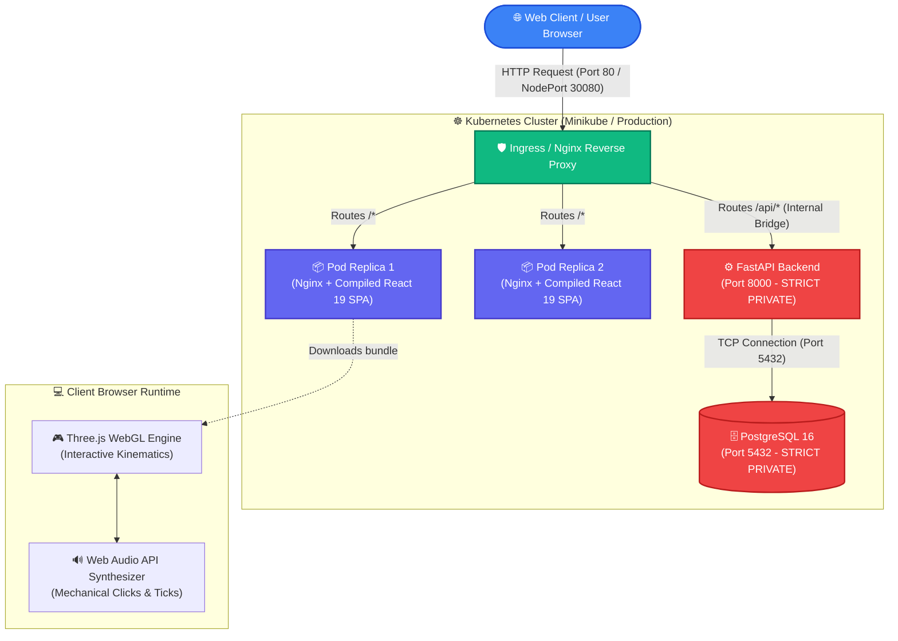
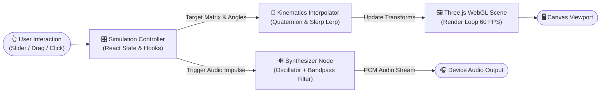
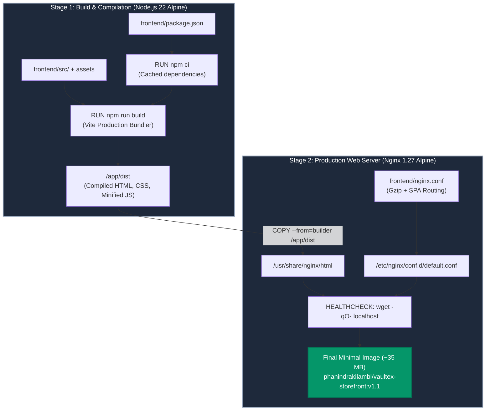
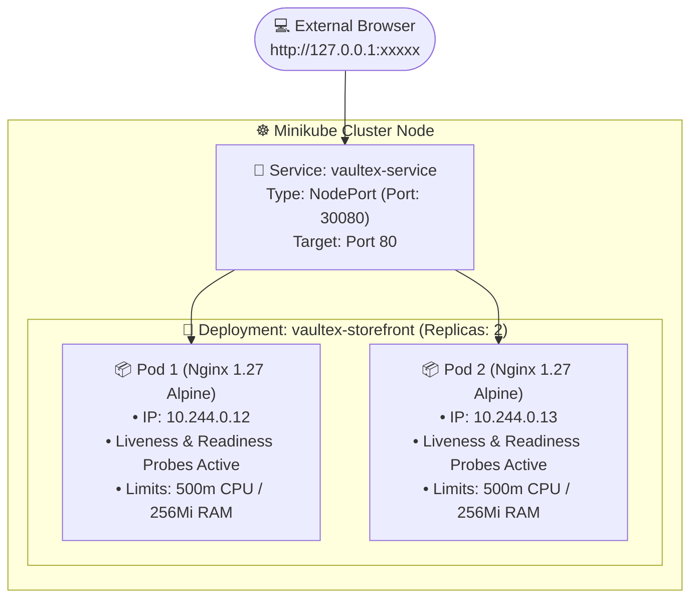

# VAULTEX — Modern Industrial Titanium & Pocketwear Storefront

[](https://hub.docker.com/r/phanindrakilambi/vaultex-storefront)
[](https://kubernetes.io/)
[](https://react.dev/)
[](https://threejs.org/)
[](https://nginx.org/)
[](https://fastapi.tiangolo.com/)
[](https://www.postgresql.org/)

> **Engineered for Strength. Refined for Your Pocket.**  
> Inspired by the precision engineering of [Secrid](https://secrid.com/), **VAULTEX** is a next-generation 3-tier luxury everyday carry (EDC) storefront. It features **interactive 3D physics simulations** (Three.js WebGL + Web Audio API synthesizer), multi-stage **Docker containerization**, and a high-availability **Kubernetes deployment on Minikube**.

---

## Table of Contents
1. [Architecture & System Flowcharts](#architecture--system-flowcharts)
2. [Interactive 3D Simulation Mechanism Lab](#interactive-3d-simulation-mechanism-lab)
3. [Multi-Stage Docker Pipeline](#multi-stage-docker-pipeline)
4. [Kubernetes Orchestration & Service Topology](#kubernetes-orchestration--service-topology)
5. [Port Security & Ingress Model](#port-security--ingress-model)
6. [Step-by-Step Setup & Running Guide](#step-by-step-setup--running-guide)
7. [Assignment Deliverables & Artifacts](#assignment-deliverables--artifacts)
8. [Project Structure](#project-structure)

---

## Architecture & System Flowcharts

### 1. End-to-End System Architecture



---

### 2. 3D Simulation Kinematics & Web Audio Engine



---

### 3. Multi-Stage Docker Build Lifecycle



---

## Interactive 3D Simulation Mechanism Lab

Every luxury item in the storefront features a dedicated **interactive physics simulator** powered by **Three.js** and procedural **Web Audio API sound design**:

| Product Category | Interactive Simulation Capabilities | Acoustic Design |
| :--- | :--- | :--- |
| **Cardprotectors & Wallets** | Dual-lever cascading card deployment, 153° leather folio unfolding, banknote tension clip. | Authentic metallic spring click, sliding polymer card friction. |
| **Mechanical Timepieces** | Smooth 6-beat/sec sweeping mechanical seconds hand, crown winding, SuperLuminova BGW9 night lume. | Mechanical escapement tick, ratcheting crown winding audio. |
| **Wireless ANC Earbuds** | Magnetic Hall-sensor lid opening, real-time 45dB noise cancellation wave inversion spectrum. | Magnetic snap click, ambient pink-noise acoustic filter. |
| **Mechanical Macropad** | Fully populated key layout (F1–F12, Alpha, Numpad), custom RGB backlighting, keycap switch travel. | Gateron mechanical tactile thud, switch bottom-out sound. |
| **EDC Tactical Flashlight** | Continuous 1 to 2,000-lumen beam slider, optical zoomable TIR lens throw, strobe mode. | Tactical tailcap toggle click. |
| **Induction Power Bank** | Qi2 magnetic snap coupling, active OLED telemetry status, thermal heat dissipation visualization. | High-frequency inductive coupling chirp. |

---

## Kubernetes Orchestration & Service Topology



* **High Availability (HA):** Two active pod replicas ensure zero downtime.
* **Rolling Update Strategy:** Zero-downtime updates with `maxSurge: 1` and `maxUnavailable: 0`.
* **Health Monitoring:** Liveness probe on `/` (period: 20s) and readiness probe (period: 10s) ensure traffic only reaches healthy containers.

---

## Port Security & Ingress Model

| Port | Protocol | Scope | Service | Security Policy |
| :--- | :--- | :--- | :--- | :--- |
| **80** | HTTP | **Public** | Nginx Reverse Proxy | Open entry point for web traffic and SPA asset delivery. |
| **30080** | TCP | **Public / Cluster** | Kubernetes NodePort | Exposes the Nginx service on Minikube nodes for browser testing. |
| **8000** | HTTP | **Strictly Private** | FastAPI ASGI Server | Isolated in private container bridge. Accessible only via reverse proxy `/api` route. |
| **5432** | TCP | **Strictly Private** | PostgreSQL 16 DB | Strictly isolated database. Zero public ingress prevents automated internet attacks. |

---

## Step-by-Step Setup & Running Guide

### 1. Prerequisites
* **Node.js 22+** and **npm** installed.
* **Python 3.12+** (optional, for backend development).
* **Docker Desktop** (with WSL 2 enabled on Windows).
* **Minikube & Kubectl** (`winget install Kubernetes.minikube Kubernetes.kubectl`).

---

### 2. Local Frontend Development
```bash
# Navigate to frontend and install dependencies
cd frontend
npm install

# Start development server with Hot Module Replacement (HMR)
npm run dev
```
Open **`http://localhost:5173`** in your browser.

---

### 3. Local Backend Development (Optional)
```bash
# Navigate to backend and create virtual environment
cd backend
python -m venv venv
venv\Scripts\activate       # On Windows (or source venv/bin/activate on Linux/Mac)

# Install dependencies and start FastAPI server
pip install -r requirements.txt
uvicorn app.main:app --reload --port 8000
```
API Documentation will be live at **`http://localhost:8000/docs`**.

---

### 4. Build & Push Docker Image to Docker Hub
```bash
# 1. Build production image using the multi-stage Dockerfile
docker build -t phanindrakilambi/vaultex-storefront:v1.1 .

# 2. Authenticate with Docker Hub
docker login

# 3. Push image to Docker Hub
docker push phanindrakilambi/vaultex-storefront:v1.1
```
* **Public Docker Hub URL:** 👉 [hub.docker.com/r/phanindrakilambi/vaultex-storefront](https://hub.docker.com/r/phanindrakilambi/vaultex-storefront)

---

### 5. Deploy to Kubernetes (Minikube)
```bash
# 1. Start Minikube cluster
minikube start --driver=docker

# 2. Apply Kubernetes Deployment and Service manifests
kubectl apply -f deployment.yaml
kubectl apply -f service.yaml

# 3. Verify Pods and Service are running
kubectl get pods -l app=vaultex-storefront -o wide
kubectl get service vaultex-service

# 4. Open the application in your browser via Minikube
minikube service vaultex-service
```
*(Alternatively, execute the automation script: `.\deploy-docker-k8s.ps1`)*

---

## Assignment Deliverables & Artifacts

| Deliverable | Path | Description |
| :--- | :--- | :--- |
| **Dockerfile** | [`Dockerfile`](./Dockerfile) | Multi-stage build (Node 22 compiler $\to$ lightweight Nginx Alpine on Port 80). |
| **Docker Hub Link** | [Docker Hub Repository](https://hub.docker.com/r/phanindrakilambi/vaultex-storefront) | Tag: `phanindrakilambi/vaultex-storefront:v1.1`. |
| **deployment.yaml** | [`deployment.yaml`](./deployment.yaml) | Kubernetes deployment with 2 replicas, rolling updates & health probes. |
| **service.yaml** | [`service.yaml`](./service.yaml) | NodePort service (`30080`) mapping external traffic to port 80. |
| **Automation Script** | [`deploy-docker-k8s.ps1`](./deploy-docker-k8s.ps1) | One-command PowerShell script executing the full build, push, deploy, and verify flow. |

---

## Project Structure

```text
infoziant-e-commerce/
├── Dockerfile                   # Multi-stage production container build manifest
├── .dockerignore                # Build context exclusion list
├── deployment.yaml              # Kubernetes Deployment specification (2 Replicas, Probes)
├── service.yaml                 # Kubernetes NodePort Service specification (Port 30080)
├── deploy-docker-k8s.ps1        # Automated PowerShell deployment script
├── README.md                    # System architecture, flowcharts & running documentation
│
├── frontend/                    # React 19 + Vite SPA Storefront
│   ├── nginx.conf               # Production Nginx reverse proxy & SPA routing config
│   ├── package.json             # NPM dependencies & build scripts
│   ├── src/
│   │   ├── components/          # Storefront UI components
│   │   │   ├── Hero.jsx         # 3D interactive hero showcase & tilt cards
│   │   │   ├── Navbar.jsx       # Header navigation & audio controls
│   │   │   ├── Footer.jsx       # Footer specifications & links
│   │   │   ├── ProductCatalog.jsx # Responsive product display & filters
│   │   │   └── simulations/     # Three.js 3D Simulation Engines
│   │   │       ├── ItemSimulator.jsx           # Master simulator router
│   │   │       ├── WatchSimulator.jsx          # Mechanical movement & escapement
│   │   │       ├── WalletSimulator.jsx         # Card cascading & leather unfolding
│   │   │       ├── EarbudsSimulator.jsx        # ANC wave spectrum & magnetic lid
│   │   │       ├── MechanicalKeypadSimulator.jsx # Full-key layout & RGB lighting
│   │   │       ├── FlashlightSimulator.jsx     # CREE LED beam throw & zoom TIR
│   │   │       └── PowerbankSimulator.jsx      # Magnetic induction & OLED telemetry
│   │   ├── data/
│   │   │   └── products.js      # Complete catalog data with 5-angle studio photos
│   │   └── utils/
│   │       ├── audio.js         # Web Audio API procedural sound synthesizer
│   │       └── threeTextures.js # Procedural canvas shaders & 3D textures
│
└── backend/                     # FastAPI ASGI Backend & Database Layer
    ├── requirements.txt         # Python dependencies
    └── app/
        ├── main.py              # FastAPI application endpoints & CORS
        ├── database.py          # SQLAlchemy connection & session manager
        ├── models.py            # PostgreSQL database models (Products, Orders)
        ├── schemas.py           # Pydantic validation schemas
        └── seed_data.py         # Initial database seeding routines
```

---

## License & Credits
* Developed for **VAULTEX Industrial Everyday Carry & Smart Tech**.
* Copyright © 2026 **VAULTEX LUXURY POCKETWEAR PVT. LTD.**
